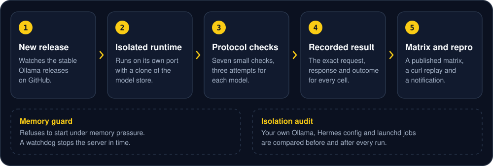

<p align="center">
  <a href="https://lil-clanky.github.io/stack-canary/"></a>
</p>

<p align="center">
  <a href="https://github.com/Lil-Clanky/stack-canary/actions/workflows/test.yml"></a>
  <a href="https://lil-clanky.github.io/stack-canary/"></a>
  
  
  <a href="LICENSE"></a>
</p>

Ollama ships often, and each release can change how a model's tool calls are
parsed. An agent built on top then breaks without an error: a tool call turns
into plain text, a stream never ends, or a file argument arrives altered.

**Stack Canary runs the same small checks against every Ollama release, for
each model, and records the result per version, model and check.** It measures
protocol behavior, not answer quality.

## The matrix today

<p align="center">
  <a href="https://lil-clanky.github.io/stack-canary/"></a>
</p>

The image shows the latest published run. The
[live page](https://lil-clanky.github.io/stack-canary/) adds the attempts,
the reasons and a repro draft for each failing cell. There is also a
[Markdown version](https://github.com/Lil-Clanky/stack-canary/blob/matrix/MATRIX.md).

## What it caught

On Ollama 0.40.16, the current stable release, and on 0.40.15, check A6 fails
3 of 3 attempts for `qwen3.5:0.8b`. The model is asked to write a file with one
line of TypeScript. The tool call comes back well formed, but the `content`
argument is altered:

```diff
- type Box<T=any> = { value: T };
+ type Box<T name="any"> = { value: T };
```

The same model passes the plain tool call (A3), and `llama3.2:3b` and
`granite4:3b-h` pass A6 on both versions. This matches case 1 of
[ollama/ollama#19694](https://github.com/ollama/ollama/issues/19694): the
Qwen 3.5 parser rewrites any `<name=value>` text inside a parameter value. An
agent that writes TypeScript generics, C++ templates or JSX through this parser
gets silently altered files.

Earlier, the full Mac mini matrix passed all 108 attempts across Ollama 0.40.16
and 0.40.15, three models, and checks A1–A5 and B6. Hermes v0.23.2 ran B6 in
foreground mode. A back-test of `llama3.2:3b` on Ollama 0.8.0 and 0.7.1 passed
A1–A5. See the [review](tasks/todo.md#review) for isolation evidence, runner and
GPU measurements, and known limitations.

## How it works

<p align="center">
  
</p>

Each release runs on a separate port with its own clone of the model store,
and an audit checks afterwards that your own Ollama was not touched. Every
attempt records the exact request and response. A cell that fails, flakes or times out gets a Markdown
draft with a `curl` command that replays it.

## Checks

| Check | Request | Passes when |
| --- | --- | --- |
| A1 | Chat | The reply contains CANARY and finishes with `stop`. |
| A2 | Streaming chat | The SSE stream has CANARY, `stop` and `[DONE]`. |
| A3 | Tool call | A `get_weather` call with Amsterdam and finish reason `tool_calls`, without tool markup in the content. |
| A4 | Streaming tool call | The same, assembled from streamed deltas. |
| A5 | Tool result round trip | The answer after the tool result contains 17 and makes no new call. |
| A6 | Code in tool arguments | A `write_file` call whose `content` is exactly `type Box<T=any> = { value: T };`. |
| B6 | Hermes Agent | Hermes writes a file with the exact expected content through a recording proxy. |

## Requirements

Python 3.11 or newer, with no runtime dependencies. Checks against an endpoint
you start yourself run on any platform. Managed Ollama runs and the Hermes
check are macOS-only.

## Quick start

Clone the repository, install it, then run the tests.

```sh
git clone https://github.com/Lil-Clanky/stack-canary && cd stack-canary
python -m pip install -e ".[dev]"
python -m pytest
```

Start the fixture on an ephemeral loopback port.

```sh
python tests/fake_ollama.py --port 0 --mode ok
```

In a second terminal, substitute the URL printed by the fixture.

```sh
canary run --endpoint http://127.0.0.1:49152 --models a,b
```

The table shows the outcome of each check. The default is three attempts per
model and check. Use `--checks A1,A4`, `--repeats 1`, or `--results-dir DIR`
to change the run. To exercise a failure, use a fault model such as
`--models fake:flaky --checks A1`. The fixture also accepts fault modes via
`--mode`. The endpoint must be loopback HTTP on an explicit port other than
`11434`.

Copy `canary.toml.example` to `canary.toml` to configure the default attempt
count, output directory, deadlines, stall timeout, and thinking-capable
models. The defaults are a 120-second deadline and a 30-second stall timeout.
Explicit command-line settings take precedence.

Each run writes a UTC-stamped `results/*_endpoint.json` by default. It records
model digests from `/api/tags` when available, plus the exact request JSON,
response body or timestamped SSE lines, and machine-readable reasons for each
attempt. Exit status is 0 for all pass, 1 for any non-pass check, and 2 for
an infrastructure or usage error.

## Documentation

| Topic | In the reference |
| --- | --- |
| Running real Ollama releases side by side | [Managed Ollama usage](docs/reference.md#managed-ollama-usage) |
| Why a run can refuse to start on a small Mac | [Memory safety](docs/reference.md#memory-safety) |
| A first real run on macOS | [Live smoke test](docs/reference.md#live-smoke-test-macos) |
| The agent check through Hermes | [Hermes Layer B](docs/reference.md#hermes-layer-b) |
| The HTML report and the repro drafts | [Compatibility report and repro drafts](docs/reference.md#compatibility-report-and-repro-drafts) |
| Nightly runs, cleanup and notifications | [Scheduling](docs/reference.md#scheduling) |
| Publishing your own matrix | [Publishing the matrix](docs/reference.md#publishing-the-matrix) |

See [the project checklist](tasks/todo.md) for planned work.
