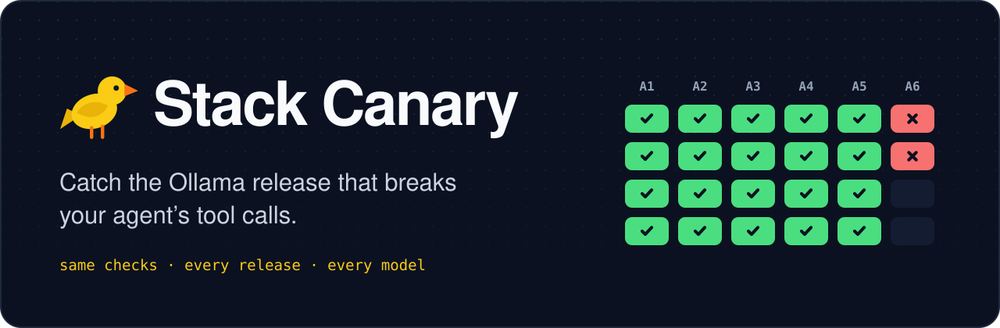
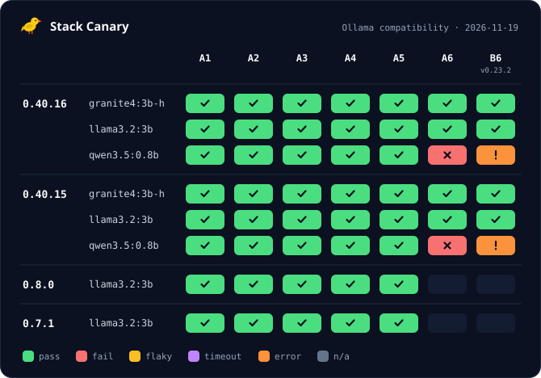

<p align="center">
  <a href="https://lil-clanky.github.io/stack-canary/"></a>
</p>

<p align="center">
  <a href="https://github.com/Lil-Clanky/stack-canary/actions/workflows/test.yml"></a>
  <a href="https://lil-clanky.github.io/stack-canary/"></a>
  <a href="LICENSE"></a>
</p>

Stack Canary runs the same tool-call checks against each Ollama release, for the
models you use. It shows which release changed a result and writes a `curl`
command that reproduces it.

## Example

[ollama/ollama#19694](https://github.com/ollama/ollama/issues/19694) is the kind
of bug it finds. On Ollama 0.40.16, `qwen3.5:0.8b` is asked to call a
`write_file` tool with this line:

```ts
type Box<T=any> = { value: T };
```

The tool call that comes back contains this instead:

```ts
type Box<T name="any"> = { value: T };
```

There is no error and `finish_reason` is `tool_calls`, so an agent would write
the changed line to disk. Ollama's Qwen 3.5 parser reads `<T=any>` as an XML tag
with an attribute. Check A6 tests for this.

## Latest run

<p align="center">
  <a href="https://lil-clanky.github.io/stack-canary/"></a>
</p>

The image is updated after each run. The [live page](https://lil-clanky.github.io/stack-canary/)
has the details of every attempt and the repro commands.

## Checks

| | Sends | Passes when |
| --- | --- | --- |
| A1 | A plain chat message | the reply says CANARY and stops normally |
| A2 | The same, streamed | the stream says CANARY and ends with `[DONE]` |
| A3 | A `get_weather` tool | the call comes back as a tool call for Amsterdam, with no tool markup in the text |
| A4 | The same, streamed | the streamed pieces add up to that call |
| A5 | A tool result | the model uses it, answers 17, and stops calling tools |
| A6 | A `write_file` tool | `type Box<T=any> = { value: T };` arrives unchanged |
| B6 | A real agent, [Hermes](https://github.com/NousResearch/hermes-agent) | the file it writes has exactly the right content |

Each check runs three times per model.

## Usage

Managed runs need macOS and Python 3.11 or newer. There are no other
dependencies.

```sh
git clone https://github.com/Lil-Clanky/stack-canary && cd stack-canary
python3 -m venv .venv && source .venv/bin/activate
pip install -e .

canary run --ollama last:2 --models qwen3.5:0.8b --checks A3,A6 --context-length 8192
canary report && open report/index.html
```

This downloads the two latest Ollama releases and pulls the model if you don't
have it yet. Each release runs on port 11535 with its own copy-on-write clone of
the model files, so your own Ollama on port 11434 keeps running. After the run,
an audit checks that your Ollama, its models and your launch agents are
unchanged. Add `--dry-run` to see what it would download first.

You can also test an Ollama server you started yourself:

```sh
canary run --endpoint http://127.0.0.1:8080 --models qwen3.5:0.8b
```

For a server with an OpenAI-compatible API that is not Ollama, use
`--openai-endpoint` with a loopback base URL ending in `/v1`. The models come from `/v1/models` unless you
pass `--model`, and `--api-key-env NAME` sends a Bearer key read from the
environment. See [docs/reference.md](docs/reference.md#your-own-server).

To run it every night and only test what hasn't been tested yet:

```sh
canary schedule install --at 04:30
```

Set `notify = ["macos"]` in `canary.toml` to get a notification when a check
starts failing.

## Memory

I run this on a Mac mini with 16 GB. It reset once during a run with a 64K
context, so Stack Canary now checks memory pressure and swap before it starts
Ollama or loads a model. During a run, a watchdog stops Ollama if memory
pressure becomes critical or swap grows past the limit. Attempts stopped this
way are reported as `error` instead of `fail`, so they don't show up as an
Ollama regression.

## Docs

- [docs/reference.md](docs/reference.md) covers managed runs, the Hermes check,
  the report, scheduling and publishing your own matrix.
- [tasks/todo.md](tasks/todo.md) is the project log, with open issues and the
  measurements behind them.

To run the tests: `pip install -e ".[dev]" && pytest`. They use a fake Ollama
server, so you don't need any models.

## License

MIT
